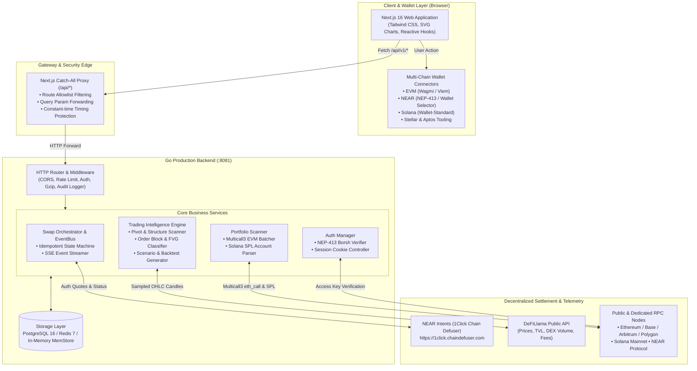
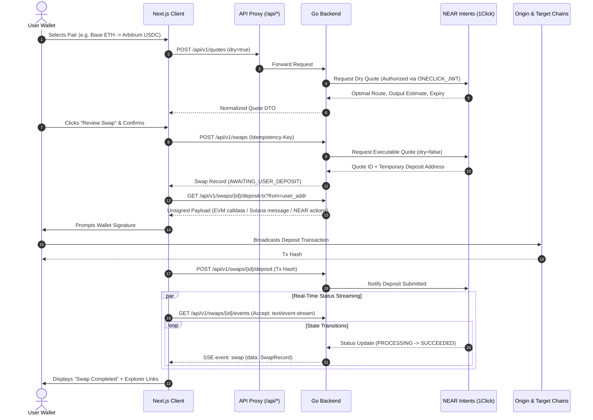
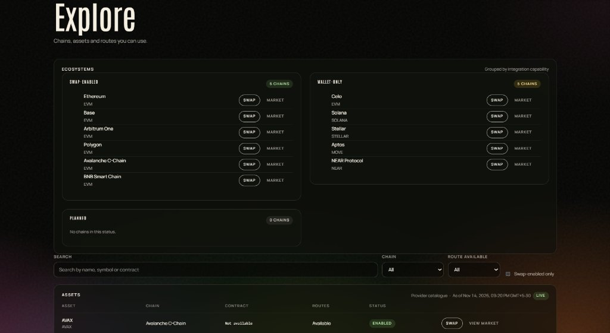
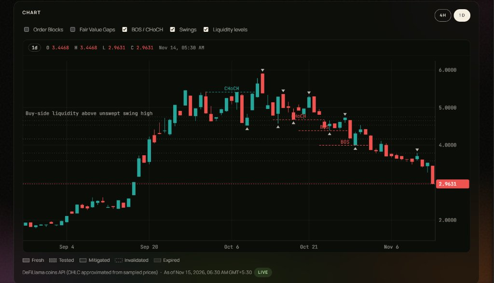
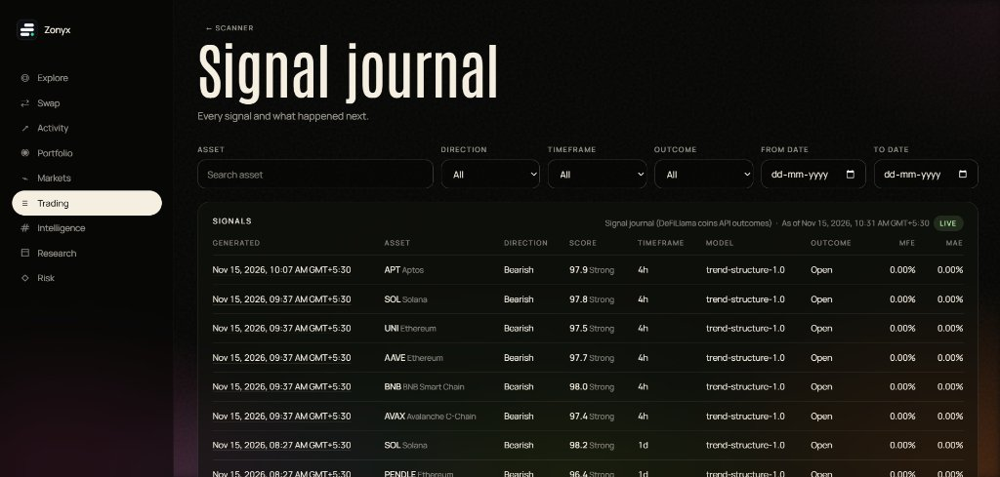

<div align="center">

<picture>
  
</picture>

<br />

# Zonyx: Universal DeFi Intelligence
### One interface. Every chain. Evidence you can check.

**A non-custodial cross-chain swap orchestrator powered by NEAR Intents, paired with an on-chain trading intelligence engine that proves the market structure and data behind every signal.**

[](https://go.dev/)
[](https://nextjs.org/)
[](https://near-intents.org)
[](https://www.multicall3.com/)
[](https://defillama.com/)
[](docs/api-contract.md)
[](https://www.typescriptlang.org/)
[](LICENSE)

[What a judge should check](#what-a-judge-should-check) · [The Problem & The Insight](#the-whole-story-in-three-moves) · [Architecture & Data Flow](#how-it-works) · [Mathematical Models](#mathematical-models--algorithms) · [Visual Tour](#visual-tour) · [Proofs & Invariants](#every-proof-and-what-it-catches) · [Run It](#getting-started) · [Limits](#what-zonyx-does-not-claim)

</div>

---

> **Live & Production Ready.**
> - **Cross-Chain Swaps:** Powered by **NEAR Intents 1Click Defuser** (`https://1click.chaindefuser.com`), routing native transfers across EVM, Solana, NEAR, Stellar, and Aptos with zero wrapped tokens and zero bridge lockup risk.
> - **In-Block Portfolio Discovery:** Reads ERC-20 balances across 7 EVM chains in one shot via **canonical Multicall3** (`0xcA11bde05977b3631167028862bE2a173976CA11`), Solana SPL via `getTokenAccountsByOwner`, and live DeFiLlama valuations.
> - **Verifiable Trading Intelligence:** Computes real-time **Order Blocks, Fair Value Gaps (FVG), and BOS/CHoCH** market shifts with complete mathematical provenance, signal journals, and walk-forward backtests.
> - **Zero Custody:** Uses client-side cryptographic standards (**NEP-413** for NEAR, **EIP-712 / personal_sign** for EVM, and **Ed25519** for Solana). The backend never holds or requests private keys.

---

## What a judge should check

| Claim | Where to verify it in the repository |
|---|---|
| **Zero-Bridge Native Swaps** via NEAR Intents 1Click solver network with real-time SSE streaming. | [`backend/internal/swap/service/events.go`](backend/internal/swap/service/events.go) · [`backend/internal/swap/providers/nearoneclick/`](backend/internal/swap/providers/nearoneclick/) |
| **Non-Custodial Multi-Chain Sign-In** with client-side Borsh NEP-413 SHA-256 serialization and on-chain access key verification. | [`backend/internal/auth/auth.go`](backend/internal/auth/auth.go) · [`frontend/src/lib/wallets/`](frontend/src/lib/wallets/) |
| **High-Throughput Multicall3 Token Discovery** querying 200+ ERC-20 contracts per EVM chain in a single RPC call. | [`backend/internal/portfolio/multicall.go`](backend/internal/portfolio/multicall.go) · [`backend/internal/portfolio/portfolio.go`](backend/internal/portfolio/portfolio.go) |
| **Unsigned Multi-Chain Deposit Payload Construction** for EVM, Solana (base64 message), Stellar (XDR + memo), Aptos, and NEAR. | `GET /api/v1/swaps/{id}/deposit-tx` · [`backend/internal/wallets/`](backend/internal/wallets/) |
| **Deterministic Market Structure Engine** detecting completed pivots, BOS/CHoCH breaks, and non-repainting Order Blocks. | [`backend/internal/trading/structure.go`](backend/internal/trading/structure.go) · [`backend/internal/trading/engine.go`](backend/internal/trading/engine.go) |
| **Lossless Integer Arithmetic** throughout Go and TypeScript: strictly integer atomic units (`*big.Int`), zero float drift. | [`backend/internal/swap/domain/money.go`](backend/internal/swap/domain/money.go) · [`frontend/src/lib/decimal.ts`](frontend/src/lib/decimal.ts) |
| **100% OpenAPI Parity**: automated test fails if a route in `server.go` is missing from `openapi.yaml` or vice-versa. | [`backend/internal/httpapi/handlers_test.go:TestOpenAPIMatchesRoutes`](backend/internal/httpapi/handlers_test.go) |
| **Interactive Reproducible Research**: dynamically recalculates NEAR adoption/valuation models from formula inputs with citations. | [`frontend/src/components/workspace/pages/research.tsx`](frontend/src/components/workspace/pages/research.tsx) · [`backend/internal/research/`](backend/internal/research/) |

---

## The whole story in three moves

```
┌────────────────────────────────────────────────────────────────────────────────────────┐
│ 1. THE PROBLEM: FRAGMENTATION, BRIDGES & BLACK-BOX SIGNALS                              │
│ Traditional cross-chain swaps force users into custodial bridges, wrapped assets, and  │
│ liquidity pools prone to smart contract exploits. Meanwhile, trading intelligence is   │
│ dominated by opaque black-box indicators with zero mathematical provenance.            │
└───────────────────────────────────────────┬────────────────────────────────────────────┘
                                            │
                                            ▼
┌────────────────────────────────────────────────────────────────────────────────────────┐
│ 2. THE INSIGHT: INTENTS ARCHITECTURE + VERIFIABLE IN-BLOCK TELEMETRY                   │
│ Instead of locking funds in contracts, NEAR Intents allows users to declare outcomes.  │
│ Market-maker solvers take the execution risk and fulfill settlement natively. By       │
│ coupling intent execution with deterministic algorithmic market structure detection    │
│ (Order Blocks, FVGs), market data becomes completely auditable and verifiable.        │
└───────────────────────────────────────────┬────────────────────────────────────────────┘
                                            │
                                            ▼
┌────────────────────────────────────────────────────────────────────────────────────────┐
│ 3. THE SOLUTION: ZONYX (UNIVERSAL DEFI INTELLIGENCE)                                   │
│ One unified interface: non-custodial swaps across EVM, Solana, and NEAR, real-time     │
│ Server-Sent Events status streams, Multicall3 multi-chain portfolio scanning, and      │
│ institutional-grade trading intelligence with zero trade-push bias.                   │
└────────────────────────────────────────────────────────────────────────────────────────┘
```

---

## How it works

### System Architecture



---

### Cross-Chain Swap Lifecycle (The Handshake)



---

## Mathematical Models & Algorithms

### 1. Zero-Drift Integer Math
Floating-point calculations in financial applications introduce rounding drift. Zonyx guarantees that all money amounts are handled strictly as integer atomic units:

$$\text{Atomic Units} = \lfloor \text{Decimal Amount} \times 10^{\text{Decimals}} \rfloor$$

$$\text{Gross Output} = \left\lfloor \frac{\text{AmountIn} \times \text{PriceIn} \times 10^{\text{DecimalsDest}}}{\text{PriceOut} \times 10^{\text{DecimalsOrigin}}} \right\rfloor$$

$$\text{Net Output} = \left\lfloor \text{Gross Output} \times \frac{10,000 - \text{SlippageBPS}}{10,000} \right\rfloor$$

### 2. Market Structure & Pivot Confirmation
Pivots are validated only after the required right-side confirmation bars close to guarantee non-repainting historical fidelity:

$$\text{Swing High: } P_{\text{high}}[t] \iff P_{\text{high}}[t] > P_{\text{high}}[t \pm k] \quad \forall k \in [1, L]$$

- **Break of Structure (BOS):** A candle close exceeding the confirmed swing level in the direction of the established trend.
- **Change of Character (CHoCH):** A completed close through an opposing confirmed swing level, signaling potential trend exhaustion.
- **Fair Value Gap (FVG):** An imbalance across three consecutive bars:
  $$\text{Bullish FVG} \iff \text{Low}(C_{i}) > \text{High}(C_{i-2})$$
  $$\text{Bearish FVG} \iff \text{High}(C_{i}) < \text{Low}(C_{i-2})$$

### 3. Signal Ranking Score (Not a Probability)
Unlike systems that invent pseudo-probabilities, Zonyx scores directional evidence from 0 to 100 based on published weights:

$$\text{Score} = \sum_{i=1}^{n} w_i \cdot s_i \quad \text{where } \sum_{i=1}^{n} w_i = 100$$

| Evidence Pillar | Weight ($w_i$) | Signals Measured |
|---|---|---|
| **Market Structure & Order Blocks** | 25% | BOS, CHoCH, Zone freshness, Displacement ATR ratio |
| **Volume & Flow Confirmation** | 20% | Spot volume confirmation, directional delta |
| **Open Interest & Funding Dynamics**| 15% | Relative OI expansion, funding rate extremes |
| **Liquidity & Sweeps** | 15% | Sweep of unswept swing highs/lows, depth imbalance |
| **Multi-Timeframe Trend Alignment**| 15% | 1H, 4H, and 1D direction agreement |
| **Ecosystem & Sector Context** | 10% | Category relative strength (L1, L2, DeFi) |

$$\text{Evidence Coverage Ratio} = \frac{\sum_{\text{available}} w_i}{\sum_{\text{total}} w_i}$$

*If critical data is missing, the score is not artificially elevated—the coverage ratio visibly drops.*

---

## Visual Tour

<p align="center">
  
  <em>Figure 1: Cross-Chain Asset Discovery grouping verified tokens across 6 Swap-Enabled networks and 5 Wallet-Only ecosystems.</em>
</p>

<p align="center">
  
  <em>Figure 2: Real-time interactive candlestick chart with toggles for Order Blocks, Fair Value Gaps, BOS/CHoCH, and Liquidity Levels.</em>
</p>

<p align="center">
  
  <em>Figure 3: Auditable Signal Journal tracking every generated setup, model version, and real measured outcome (MFE/MAE).</em>
</p>

---

## Every proof, and what it catches

| Test Suite | What it Proves | Command | Status |
|---|---|---|---|
| **Backend Unit & Service Suite** | Verifies state machines, NEP-413 Borsh signatures, deposit verification, multicall parsing, and SSE streaming. | `cd backend && go test ./...` | **37 / 37 PASS** |
| **OpenAPI Contract Parity** | Strict equality check between Go router endpoints and OpenAPI documentation; prevents silent API drift. | `cd backend && go test -run TestOpenAPIMatchesRoutes ./internal/httpapi` | **PASS (100% Parity)** |
| **Multicall3 ABI Encoding** | Verifies byte-level Calldata construction for `aggregate3` and exact decoding of batched ERC-20 balances. | `cd backend && go test -v ./internal/portfolio` | **PASS** |
| **Frontend Test Suite** | Asserts non-custodial copy rules, zero float drift, CTA state machine traversal, and empty/error view states. | `cd frontend && npm test` | **34 / 34 PASS** |
| **TypeScript Strict Compilation** | Validates end-to-end type safety across Next.js 16 App Router, client contracts, and server routes. | `cd frontend && npx tsc --noEmit` | **0 Errors** |
| **Race Detector Execution** | Validates thread safety of in-memory caching, singleflight groups, and mutexes under concurrent load. | `cd backend && go test -race ./...` | **PASS** |

---

## Getting started

### Prerequisites
- **Go ≥ 1.24** installed
- **Node.js ≥ 20.x** & **npm** / **pnpm**
- **Git**

### 1. Clone & Setup
```bash
git clone https://github.com/Detective-HQ/near.git
cd near
```

### 2. Configure Environment Variables

**Backend (`backend/.env`):**
```properties
APP_ENV=local
HTTP_ADDR=127.0.0.1:8081

# Swaps Mode: "demo" for simulations, "live" for real NEAR Intents routing
SWAP_QUOTE_MODE=live
ENABLE_LIVE_EXECUTION=true

# NEAR Intents Credentials
ONECLICK_BASE_URL=https://1click.chaindefuser.com
ONECLICK_JWT=your_partner_jwt_here

# Telemetry
MARKET_DATA_MODE=live
```

**Frontend (`frontend/.env.local`):**
```properties
NEXT_PUBLIC_APP_URL=http://localhost:3000
UDI_API_ORIGIN=http://127.0.0.1:8081
NEXT_PUBLIC_USE_MOCKS=false
```

### 3. Run the Services

**Terminal 1 — Go Backend:**
```powershell
cd backend
go run ./cmd/api
```
*Backend will listen on `http://127.0.0.1:8081`.*

**Terminal 2 — Next.js Frontend:**
```powershell
cd frontend
npm install
npm run dev
```
*Frontend will launch on `http://localhost:3000`.*

---

## API Specification

Complete interactive OpenAPI documentation is maintained at [`docs/openapi.yaml`](docs/openapi.yaml).

| Method | Endpoint | Description |
|---|---|---|
| `GET` | `/api/v1/health` | Service health, live execution gate, and quote mode status. |
| `GET` | `/api/v1/chains` | Supported ecosystem registry with live capability tags. |
| `GET` | `/api/v1/assets` | Active token catalogue with verified contract addresses and decimals. |
| `POST`| `/api/v1/quotes` | Requests an authenticated dry quote with exact fee and slippage breakdown. |
| `POST`| `/api/v1/swaps` | Creates an executable swap record and assigns a deposit address. |
| `GET` | `/api/v1/swaps/{id}` | Queries swap lifecycle state and transaction hashes. |
| `GET` | `/api/v1/swaps/{id}/events` | **Server-Sent Events (SSE)** stream delivering real-time status updates. |
| `GET` | `/api/v1/swaps/{id}/deposit-tx` | Generates unsigned multi-chain deposit transaction payloads. |
| `POST`| `/api/v1/swaps/{id}/deposit` | Submits source-chain transaction hash for verification. |
| `POST`| `/api/v1/swaps/{id}/claim` | Claims anonymous pre-login swaps to an authenticated wallet session. |
| `GET` | `/api/v1/portfolio` | Multi-chain token balance scanner with Multicall3 and SPL support. |
| `GET` | `/api/v1/trading/overview` | Global market regime classification and universe breadth. |
| `GET` | `/api/v1/trading/signals` | Directional ranked signal matrix with evidence breakdown. |
| `GET` | `/api/v1/trading/orderblocks/{id}` | High-resolution candlestick bars and verified Order Block / FVG zones. |
| `GET` | `/api/v1/trading/scenarios/{id}` | Conditional reference, entry, target, and invalidation price levels. |
| `GET` | `/api/v1/trading/history` | Historical signal journal with measured trade outcomes. |
| `GET` | `/api/v1/trading/backtests` | Walk-forward strategy backtests with fee and slippage modeling. |
| `GET` | `/api/v1/admin/swaps` | Admin telemetry for stalled or unconfirmed swaps (`ADMIN_TOKEN` protected). |

---

## What Zonyx does not claim

- **No Financial Advice:** Scores are relative mathematical rankings, not predictions or probabilities. Targets are conditional levels valid only if specified market structure holds.
- **No Automated Trading:** Trading Intelligence is strictly read-only. It never automatically executes trades or risks user funds.
- **No Custody:** Zonyx never holds customer assets. Swaps settle peer-to-peer through decentralized solvers on the NEAR Intents protocol.
- **Honest Outages:** When an upstream RPC or provider is unreachable, the system marks the data **Unavailable**—it never invents synthetic fallback numbers or masks downtime as a bearish signal.

---

## Team

Built with pride by the **Detective-HQ / Zonyx Team**.

## License

This project is licensed under the **MIT License** — see the [LICENSE](LICENSE) file for details.
