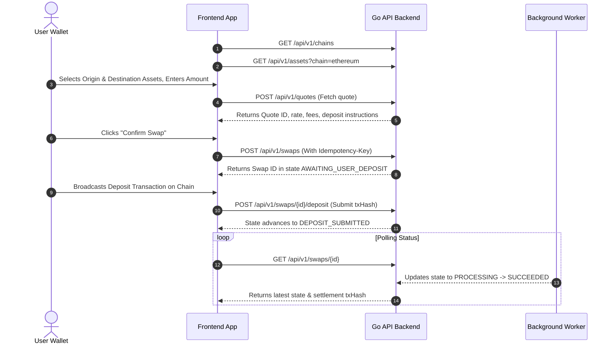

# Universal DeFi Intelligence (UDI) — Frontend Backend Integration Guide

> **Target Audience:** Frontend engineers building UI features, forms, wallets, and swap widgets.  
> **Backend Service:** Go 1.26 HTTP API (`cmd/api`) listening on port `8081`.  
> **API Base URL:** All requests from frontend components should target `/api/v1/*`. Next.js automatically proxies these requests to the Go API backend via `frontend/src/app/api/[...path]/route.ts`.

---

## 1. Quick Start & Architecture Overview

```text
[ Browser / React Components ]
              │
              ▼ (calls /api/v1/...)
┌──────────────────────────────────────────────────┐
│ Next.js API Proxy (`app/api/[...path]/route.ts`)  │
│ - Forwards headers (Authorization, Cookie, Idem) │
└──────────────────────────────────────────────────┘
              │
              ▼ (proxies to http://127.0.0.1:8081)
┌──────────────────────────────────────────────────┐
│ Go Backend API (`backend/cmd/api`)               │
│ - Rate limiting & security headers               │
│ - Multi-chain validation & state machine         │
│ - PostgreSQL 16 persistence & Redis worker       │
└──────────────────────────────────────────────────┘
```

### Running Locally
To launch both the Go API backend (`:8081`) and the Next.js frontend (`:3000`) concurrently:
```bash
# In the repository root
npm run dev
```

---

## 2. Global Headers & Error Envelope

### Standard Request Headers
```http
Content-Type: application/json
Accept: application/json
Idempotency-Key: <unique-uuid-or-hash>      # Strongly recommended on POST /api/v1/swaps
Authorization: Bearer <session-token>       # Optional (required if wallet auth is enabled)
```

### Standard Error Response Format
When any request fails (HTTP 4xx or 5xx), the response body is always normalized into:
```json
{
  "error": {
    "code": "VALIDATION_FAILED",
    "message": "Human-readable explanation of the error."
  },
  "requestId": "a8f7c9e01234"
}
```

#### Common Error Codes:
| Error Code | HTTP Status | Meaning |
|---|---|---|
| `VALIDATION_FAILED` | 400 | Malformed address, invalid amount, or negative numbers |
| `WALLET_REJECTED` | 400 | User rejected wallet signature in UI |
| `UNAUTHORIZED` | 401 | Missing or invalid auth session token |
| `FORBIDDEN` | 403 | Session does not own the requested swap |
| `NOT_FOUND` | 404 | Swap ID, Quote ID, or asset not found |
| `IDEMPOTENCY_CONFLICT` | 409 | Reused `Idempotency-Key` with a different payload |
| `QUOTE_EXPIRED` | 410 | Quote validity deadline has elapsed |
| `NO_ROUTE` | 422 | No liquidity route available for this token pair |
| `RATE_LIMITED` | 429 | Rate limit exceeded (50 req/sec limit per IP) |
| `INTERNAL` | 500 | Unhandled internal server error |

---

## 3. End-to-End User Flows

### Flow A: Multi-Chain Swap Execution



---

## 4. Complete API Endpoint Reference

### 4.1 System & Health

#### `GET /api/v1/health`
Basic liveness and service metadata.
- **Response `200 OK`**:
```json
{
  "status": "ok",
  "service": "universal-defi-intelligence",
  "version": "0.1.0",
  "timestamp": "2026-11-13T20:00:00Z"
}
```

#### `GET /api/v1/risk/status`
Real-time risk engine metrics, circuit breaker state, and provider health.
- **Response `200 OK`**:
```json
{
  "status": "HEALTHY",
  "circuitBreaker": "CLOSED",
  "providerErrorRate": 0.0,
  "lastSuccessfulPoll": "2026-11-13T19:59:45Z",
  "catalogueStale": false,
  "catalogueLastRefreshed": "2026-11-13T19:50:00Z",
  "maxSlippageBps": 500,
  "warningSlippageBps": 200,
  "activeAlerts": []
}
```

---

### 4.2 Metadata & Assets

#### `GET /api/v1/chains`
List supported blockchain networks and their capabilities.
- **Response `200 OK`**:
```json
{
  "chains": [
    {
      "id": "ethereum",
      "name": "Ethereum Mainnet",
      "family": "evm",
      "nativeCurrency": "ETH",
      "swapEnabled": true
    },
    {
      "id": "solana",
      "name": "Solana",
      "family": "solana",
      "nativeCurrency": "SOL",
      "swapEnabled": true
    },
    {
      "id": "stellar",
      "name": "Stellar",
      "family": "stellar",
      "nativeCurrency": "XLM",
      "swapEnabled": true
    },
    {
      "id": "near",
      "name": "NEAR Protocol",
      "family": "near",
      "nativeCurrency": "NEAR",
      "swapEnabled": true
    }
  ]
}
```

#### `GET /api/v1/assets?chain={chainId}`
List supported token assets. Pass `?chain=<chainId>` to filter by network.
- **Response `200 OK`**:
```json
{
  "assets": [
    {
      "id": "eth-usdc",
      "chainKey": "ethereum",
      "symbol": "USDC",
      "name": "USD Coin",
      "decimals": 6,
      "contractAddress": "0xa0b86991c6218b36c1d19d4a2e9eb0ce3606eb48",
      "priceUsd": "1.00000000",
      "isEnabled": true
    }
  ]
}
```

---

### 4.3 Quoting & Swapping

#### `POST /api/v1/quotes`
Generate a swap quote between two tokens.
- **Request Body**:
```json
{
  "originAsset": "eth-usdc",
  "destinationAsset": "near-weth",
  "amountIn": "100.50",
  "recipient": "user.near",
  "slippageBps": 50
}
```
- **Response `200 OK`**:
```json
{
  "id": "quote_609e615fc82b9ec66844f06d56284fd9",
  "originAsset": { "id": "eth-usdc", "symbol": "USDC", "decimals": 6 },
  "destinationAsset": { "id": "near-weth", "symbol": "WETH", "decimals": 18 },
  "amountIn": "100.50",
  "amountInAtomic": "100500000",
  "amountOutEstimate": "0.03814",
  "amountOutEstimateAtomic": "38140000000000000",
  "minAmountOut": "0.03795",
  "feeBps": 20,
  "slippageBps": 50,
  "depositAddress": "0x1234567890abcdef1234567890abcdef12345678",
  "depositMemo": null,
  "expiresAt": "2026-11-13T20:15:00Z"
}
```

#### `POST /api/v1/swaps`
Initialize a swap from an existing quote.
- **Headers**: `Idempotency-Key: <unique-string>`
- **Request Body**:
```json
{
  "quoteId": "quote_609e615fc82b9ec66844f06d56284fd9",
  "recipient": "user.near",
  "refundAddress": "0x9876543210abcdef9876543210abcdef98765432"
}
```
- **Response `201 Created`**:
```json
{
  "id": "swap_3bbc73989156fc687a34eddd98eeada6",
  "quoteId": "quote_609e615fc82b9ec66844f06d56284fd9",
  "state": "AWAITING_USER_DEPOSIT",
  "originChain": "ethereum",
  "destinationChain": "near",
  "depositAddress": "0x1234567890abcdef1234567890abcdef12345678",
  "depositMemo": null,
  "recipient": "user.near",
  "refundAddress": "0x9876543210abcdef9876543210abcdef98765432",
  "transactions": {
    "source": null,
    "destination": null
  },
  "events": [
    {
      "state": "AWAITING_USER_DEPOSIT",
      "detail": "Swap created and awaiting deposit.",
      "at": "2026-11-13T20:00:00Z"
    }
  ],
  "createdAt": "2026-11-13T20:00:00Z"
}
```

#### `GET /api/v1/swaps/{id}`
Fetch the current state and transaction logs for a swap.
- **Response `200 OK`**:
```json
{
  "id": "swap_3bbc73989156fc687a34eddd98eeada6",
  "state": "PROCESSING",
  "transactions": {
    "source": "0xabcdef123456789...",
    "destination": null
  },
  "updatedAt": "2026-11-13T20:02:15Z"
}
```

#### `POST /api/v1/swaps/{id}/deposit`
Submit the source transaction hash after the user signs and broadcasts the on-chain deposit.
- **Request Body**:
```json
{
  "txHash": "0xabcdef1234567890abcdef1234567890abcdef1234567890abcdef1234567890",
  "chainId": "ethereum"
}
```
- **Response `202 Accepted`**:
```json
{
  "id": "swap_3bbc73989156fc687a34eddd98eeada6",
  "state": "DEPOSIT_SUBMITTED",
  "transactions": {
    "source": "0xabcdef1234567890abcdef1234567890abcdef1234567890abcdef1234567890"
  }
}
```

#### `POST /api/v1/swaps/{id}/cancel`
Cancel an unfunded swap before a deposit is broadcast.
- **Response `200 OK`**:
```json
{
  "id": "swap_3bbc73989156fc687a34eddd98eeada6",
  "state": "CANCELLED"
}
```

#### `POST /api/v1/swaps/{id}/simulate`
*(Demo / Test environment only)* Step through the swap state machine without spending real crypto.
- State transitions:
  1. `AWAITING_USER_DEPOSIT` → `SIMULATED_DEPOSIT`
  2. `DEPOSIT_SUBMITTED` / `SIMULATED_DEPOSIT` → `PROCESSING`
  3. `PROCESSING` → `SUCCEEDED`

---

### 4.4 Wallet Authentication

#### `POST /api/v1/auth/nonce`
Generate a cryptographically random nonce to include in a wallet signature.
- **Request Body**:
```json
{ "walletAddress": "0x1234...abcd", "chainFamily": "evm" }
```
- **Response `200 OK`**:
```json
{ "nonce": "4f9a8b1c2d3e4f5a6b7c8d9e0f1a2b3c" }
```

#### `POST /api/v1/auth/verify`
Verify the wallet signature (SIWE, Solana ed25519, or NEP-413) and create a session.
- **Request Body**:
```json
{
  "walletAddress": "0x1234...abcd",
  "chainFamily": "evm",
  "signature": "0xabcdef...",
  "nonce": "4f9a8b1c2d3e4f5a6b7c8d9e0f1a2b3c"
}
```
- **Response `200 OK`**:
```json
{
  "sessionToken": "ses_9876543210fedcba",
  "expiresAt": "2026-11-14T20:00:00Z"
}
```
*(Sets `Set-Cookie: udi_session=...; HttpOnly; SameSite=Lax`)*

#### `POST /api/v1/auth/logout`
Revoke the current session token.

---

### 4.5 Markets, Intelligence & Scenarios

#### `GET /api/v1/markets/overview`
Aggregated 24h metrics across supported chains (TVL, volume, fees).

#### `GET /api/v1/intelligence/near`
Deep ecosystem metrics specifically for NEAR Protocol & NEAR Intents.

#### `GET /api/v1/research/scenarios`
Deterministic fee-capture model calculations across Bear, Base, and Bull scenarios:
- **Bear Scenario Target:** \$536,112
- **Base Scenario Target:** \$3,626,219.52
- **Bull Scenario Target:** \$15,137,280

#### `GET /api/v1/activity`
Historical swaps and audit events. Supports keyset cursor pagination (`?limit=20&cursor=...`).

---

## 5. Swap State Machine Reference

```text
[CREATED]
   │
   ▼
[QUOTING]
   ├──► [QUOTE_UNAVAILABLE]   (Terminal: No liquidity route)
   ▼
[QUOTED]
   │
   ▼
[AWAITING_USER_DEPOSIT]
   ├──► [CANCELLED]           (Terminal: User cancelled before deposit)
   ├──► [EXPIRED]             (Terminal: Quote deadline passed)
   ▼
[DEPOSIT_SUBMITTED]
   │
   ▼
[PROCESSING]
   ├──► [SUCCEEDED]           (Terminal: Destination funds delivered)
   ├──► [REFUNDED]            (Terminal: Deposit returned to refundAddress)
   └──► [FAILED]              (Terminal: Unrecoverable provider error)
```

### UI Badge Color Recommendations:
- `AWAITING_USER_DEPOSIT`: Amber / Yellow (`bg-amber-500/10 text-amber-400`)
- `DEPOSIT_SUBMITTED` / `PROCESSING`: Blue (`bg-blue-500/10 text-blue-400 animate-pulse`)
- `SUCCEEDED`: Emerald / Green (`bg-emerald-500/10 text-emerald-400`)
- `CANCELLED` / `EXPIRED`: Slate / Gray (`bg-slate-500/10 text-slate-400`)
- `REFUNDED` / `FAILED`: Rose / Red (`bg-rose-500/10 text-rose-400`)

---

## 6. Special Multi-Chain Requirements for Frontend

1. **Stellar Memos:**  
   If `depositMemo` is returned in the quote response, **the Stellar transaction MUST attach the memo**. Failing to include the memo will result in permanently lost funds.
2. **Exact Decimal Parsing:**  
   Always submit human-readable decimal strings in `amountIn` (e.g. `"100.50"`). The Go backend handles exact conversion to 256-bit atomic units without floating-point rounding errors.
3. **Idempotency Keys:**  
   Always generate a fresh UUID v4 for the `Idempotency-Key` header on `POST /api/v1/swaps`. If a network glitch occurs, retrying the call with the same key will safely return the existing swap record without double-swapping.

