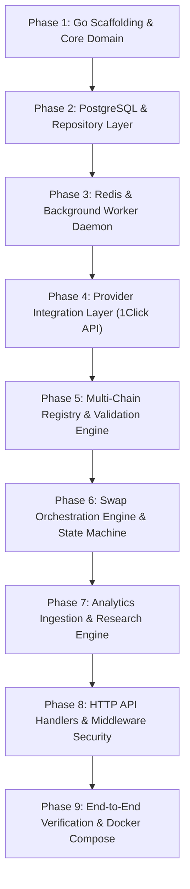

# Universal DeFi Intelligence — Go Backend & Core Infrastructure Roadmap

> **Document Version:** 1.0  
> **Target Scope:** Go Backend Migration, PostgreSQL Relational Store, Redis Worker Daemon, Multi-Chain Integrations, Analytics Pipeline, and Observability.  
> **Source Specification:** `Universal_DeFi_Intelligence_Technical_Handoff.docx`  
> *(Note: Frontend UI development is excluded from this roadmap per project directive).*

---

## 1. Executive Summary & Objective

The current codebase utilizes a temporary, single-process Node.js prototype (`server.mjs` + `lib/`) persisting records into a local flat JSON file (`data/udi.json`). Per Architecture Decision Record **ADR 0001**, this was an interim runtime.

The objective of this roadmap is to migrate the entire backend and core integration layer to the production architecture defined in the Technical Handoff Document:
1. **Language:** Go (Golang 1.23+ / 1.26+) utilizing idiomatic modular design (`cmd/`, `internal/`).
2. **API Framework:** Lightweight, high-throughput HTTP router (`net/http` or `go-chi/chi/v5`).
3. **Persistence:** PostgreSQL 16+ with strict transactional guarantees and SQL migration files.
4. **Queue & Caching:** Redis 7+ for token catalogue caching and async status polling worker.
5. **Core Engine:** Provider-agnostic swap orchestrator, deterministic decimal arithmetic, multi-chain address and transaction validation, and on-chain RPC verification.
6. **Integrations:** Direct Go clients for NEAR Intents 1Click API, DeFiLlama analytics, alternative route adapters, and multi-ecosystem chain registries (EVM, Solana, Stellar, Aptos, Celo, NEAR).

---

## 2. Current State Audit: What Is Already Done & What Can Be Ported

Although the current implementation is in JavaScript ESM (`server.mjs` and `lib/`), the core business rules, schemas, math, and contracts are already defined and validated with unit tests. These serve as direct blueprints for Go packages:

| Existing Node.js / JS Component | Existing Location | Direct Go Target Package | Porting Complexity |
| :--- | :--- | :--- | :--- |
| **Exact Decimal Math** | `lib/domain.mjs` (`parseUnits`, `formatUnits`) | `internal/swap/domain/math.go` (`big.Int` or `shopspring/decimal`) | Low (Deterministic math port) |
| **Swap State Machine** | `lib/domain.mjs` (`createSwap`, `advanceSimulation`) | `internal/swap/domain/state_machine.go` | Low (Explicit state transitions) |
| **REST API DTOs & Contracts** | `docs/openapi.yaml`, `src/lib/contracts.ts` | `internal/httpapi/dto/` | Low (Direct struct mapping with JSON tags) |
| **1Click API Client Logic** | `lib/providers/nearoneclick.mjs` | `internal/swap/providers/nearoneclick/` | Medium (HTTP client, JWT auth, bounded body read) |
| **DeFiLlama Metrics Aggregator** | `lib/providers/defillama.mjs` | `internal/analytics/connectors/defillama/` | Medium (HTTP client, metric normalization) |
| **EVM Transaction & Deposit Spec**| `src/lib/evm-wallet.ts` | `internal/wallets/evm/` and `internal/chains/evm/` | Low (Hex parsing, ERC-20 selector validation; wallet helpers separate from chain registry) |
| **Scenario Research Math** | `lib/data.mjs` (formulas, volume/capture math) | `internal/research/models/` | Low (Pure calculation engine) |
| **Structured Log Format** | `server.mjs` (JSON-formatted stdout) | `internal/observability/logger.go` (`slog`) | Low (Go standard `log/slog`) |

---

## 3. Gap Analysis: What We Need According to the Handoff Document

| Requirement in Handoff Document | Current Status in Repo | Required Go Implementation |
| :--- | :--- | :--- |
| **Go HTTP API (`services/api`)** | ❌ Missing (`server.mjs` used) | Implement Go HTTP REST API binary with graceful shutdown. |
| **Go Background Worker (`services/worker`)** | ❌ Missing (In-process JS interval used) | Independent background daemon for polling and analytics. |
| **PostgreSQL Database & Migrations** | ❌ Missing (`data/udi.json` used) | PostgreSQL schema, connection pooling (`pgx`), and migrations. |
| **Redis Cache & Lock Engine** | ❌ Missing (Node `Map` cache used) | Redis client (`go-redis/v9`) for TTL caching and distributed locks. |
| **Non-EVM Chain Address Validation** | ❌ Missing | Encoders/validators for Solana (Base58), Stellar (StrKey), Aptos, and NEAR accounts. |
| **Stellar Memo Validation** | ❌ Missing | Enforce memo validation for Stellar routes returned by provider. |
| **On-Chain RPC Receipt Verification**| ❌ Missing (Only provider polled) | Query chain RPCs to verify source deposit broadcast receipts. |
| **Alternative Route Provider Adapter**| ❌ Missing | Define Go provider interface `ProviderAdapter` for fallback routing. |
| **Audit Event Trail (`swap_events`)** | ⚠️ Partial (In JSON array) | Immutable, append-only PostgreSQL `swap_events` log. |
| **User / Session Access Boundaries** | ❌ Missing | Session / API token middleware with ownership checks (`internal/auth/`). |
| **Risk Engine (Backend)** | ❌ Missing | Slippage warnings, quote expiry, provider health, stale-data alerts (`internal/risk/`). |
| **Wallet Helpers Package** | ❌ Missing (merged into chains) | Deposit tx construction, memo attachment, token-account resolution (`internal/wallets/`). |
| **Typed Error Hierarchy** | ❌ Missing | Domain error codes matching handoff Section 12 error matrix (`NO_ROUTE`, `QUOTE_EXPIRED`, etc.). |
| **Retry Policy for Provider Calls** | ❌ Missing | Bounded retries with backoff/jitter; never retry non-idempotent `POST /v0/quote dry=false`. |
| **Data Snapshots for Research** | ❌ Missing | Immutable input snapshots with checksum for reproducible research models (`data_snapshots` table). |

---

## 4. Target Go Project Structure

In alignment with Section 5 and Section 16 of the Technical Handoff Document, the backend will be organized into clean, decoupled domain packages:

```text
universal-defi-intelligence/
├── cmd/
│   ├── api/
│   │   └── main.go                 # HTTP API Entrypoint
│   └── worker/
│       └── main.go                 # Background Worker Daemon (polling & ingestion)
├── internal/
│   ├── config/
│   │   └── config.go               # Environment configuration & validation
│   ├── httpapi/
│   │   ├── router.go               # Route setup & middleware chains
│   │   ├── middleware/             # Rate limit, CORS, RequestID, Auth, Logger
│   │   ├── handlers/               # HTTP controller handlers
│   │   │   ├── health.go
│   │   │   ├── chains.go
│   │   │   ├── assets.go
│   │   │   ├── quotes.go
│   │   │   ├── swaps.go
│   │   │   ├── activity.go
│   │   │   ├── markets.go
│   │   │   ├── intelligence.go
│   │   │   └── research.go
│   │   └── dto/                    # Request and response structures
│   ├── auth/                       # Optional session / wallet-signature auth middleware
│   ├── chains/
│   │   ├── registry/               # Chain metadata, IDs, explorer URLs, feature flags
│   │   ├── evm/                    # EVM address, chain ID, ABI, RPC verify
│   │   ├── solana/                 # Solana Base58 & SPL token validation
│   │   ├── stellar/                # Stellar StrKey & memo handling
│   │   ├── aptos/                  # Aptos address & Move type checking
│   │   └── near/                   # NEAR account & implicit account parsing
│   ├── wallets/                    # Chain-specific deposit tx construction, memo attachment, token-account resolution
│   ├── swap/
│   │   ├── domain/                 # Core models: Quote, Swap, Deposit, Math, Errors
│   │   ├── service/                # Business logic, state transitions, idempotency
│   │   ├── repository/             # Postgres DB interface & pgx queries
│   │   └── providers/
│   │       ├── adapter.go          # Provider interface abstraction
│   │       ├── nearoneclick/       # 1Click API client (catalogue, dry/exec quote, status)
│   │       └── alternative/        # Fallback provider stub
│   ├── analytics/
│   │   ├── connectors/
│   │   │   ├── defillama/          # DeFiLlama public endpoints fetcher
│   │   │   └── rpc/                # On-chain metrics indexer connector
│   │   ├── service/                # Aggregation & snapshot service
│   │   └── repository/             # Metric observations persistence
│   ├── research/
│   │   ├── models/                 # Thesis formulas (annual captured fees, sensitivity)
│   │   └── scenarios/              # Scenario definitions (Bear, Base, Bull)
│   ├── risk/                       # Slippage warnings, quote expiry, provider health, stale-data alerts
│   ├── storage/
│   │   ├── postgres/               # Postgres connection pool & transaction manager
│   │   └── redis/                  # Redis client for caching & locking
│   └── observability/
│       ├── logger.go               # Structured JSON logging (slog) with redaction
│       └── metrics.go              # Latency, quote counters, error metrics
├── migrations/
│   ├── 000001_create_assets_table.up.sql
│   ├── 000002_create_quotes_and_swaps.up.sql
│   ├── 000003_create_swap_events.up.sql
│   ├── 000004_create_data_snapshots.up.sql
│   └── 000005_create_analytics_and_research.up.sql
├── go.mod
├── go.sum
└── Dockerfile.backend
```

---

## 5. PostgreSQL Data Model & Schema Specification

The relational database replaces `data/udi.json`. Token amounts must **never** be stored as floating-point numbers; they are persisted as integer strings or `NUMERIC(78, 0)` to support up to 256-bit EVM uint256 precision.

```sql
-- 1. Supported & Discovered Assets
CREATE TABLE assets (
    id VARCHAR(255) PRIMARY KEY,              -- Provider assetId or internal unique ID
    provider_asset_id VARCHAR(512) NOT NULL,
    chain_key VARCHAR(64) NOT NULL,
    symbol VARCHAR(40) NOT NULL,
    name VARCHAR(128) NOT NULL,
    decimals INT NOT NULL,
    contract_address VARCHAR(255),
    price_usd NUMERIC(24, 8),
    is_enabled BOOLEAN DEFAULT true,          -- Soft-delete only: set false on catalogue refresh, never DELETE rows (quotes reference asset IDs)
    source VARCHAR(64) NOT NULL,
    observed_at TIMESTAMPTZ NOT NULL,
    created_at TIMESTAMPTZ DEFAULT NOW(),
    updated_at TIMESTAMPTZ DEFAULT NOW()
);
CREATE INDEX idx_assets_chain ON assets(chain_key);

-- 2. Quotes (Dry and Executable)
CREATE TABLE quotes (
    id VARCHAR(64) PRIMARY KEY,               -- e.g. qte_<uuid>
    session_id VARCHAR(128),
    provider_quote_id VARCHAR(255),
    provider_name VARCHAR(64) NOT NULL,
    mode VARCHAR(32) NOT NULL,                -- provider_dry_quote, provider_executable_quote, simulation
    origin_asset_id VARCHAR(255) NOT NULL,    -- Provider assetId; no FK — quotes outlive catalogue refreshes
    destination_asset_id VARCHAR(255) NOT NULL, -- Provider assetId; assets use soft-delete (is_enabled=false), never hard-delete
    amount_in_atomic NUMERIC(78, 0) NOT NULL,
    amount_in_decimal VARCHAR(64) NOT NULL,
    amount_out_estimate_atomic NUMERIC(78, 0) NOT NULL,
    min_amount_out_atomic NUMERIC(78, 0),
    fee_bps INT DEFAULT 0,
    slippage_bps INT DEFAULT 50,
    deposit_address VARCHAR(255),
    deposit_memo VARCHAR(255),
    expires_at TIMESTAMPTZ NOT NULL,
    raw_response_json JSONB,
    created_at TIMESTAMPTZ DEFAULT NOW()
);

-- 3. Swaps Lifecycle
CREATE TABLE swaps (
    id VARCHAR(64) PRIMARY KEY,               -- e.g. swp_<uuid>
    quote_id VARCHAR(64) REFERENCES quotes(id) NOT NULL,
    idempotency_key VARCHAR(128) UNIQUE NOT NULL,
    state VARCHAR(48) NOT NULL,               -- CREATED, QUOTING, QUOTE_UNAVAILABLE, QUOTED, AWAITING_USER_DEPOSIT, DEPOSIT_SUBMITTED, PROCESSING, SUCCEEDED, REFUNDED, FAILED, CANCELLED, EXPIRED
    provider_status VARCHAR(64),              -- Raw provider status
    real_settlement BOOLEAN DEFAULT false,
    origin_chain VARCHAR(64) NOT NULL,
    destination_chain VARCHAR(64) NOT NULL,
    deposit_address VARCHAR(255),             -- Nullable in CREATED/QUOTING; set when transitioning to AWAITING_USER_DEPOSIT
    deposit_memo VARCHAR(255),
    recipient_address VARCHAR(255) NOT NULL,
    refund_address VARCHAR(255) NOT NULL,
    created_at TIMESTAMPTZ DEFAULT NOW(),
    updated_at TIMESTAMPTZ DEFAULT NOW()
);
CREATE INDEX idx_swaps_state ON swaps(state);

-- 4. Swap Transactions (Source, Destination, Refund)
CREATE TABLE swap_transactions (
    id BIGSERIAL PRIMARY KEY,
    swap_id VARCHAR(64) REFERENCES swaps(id) ON DELETE CASCADE,
    chain_key VARCHAR(64) NOT NULL,
    tx_hash VARCHAR(255) NOT NULL,
    tx_role VARCHAR(32) NOT NULL,             -- deposit, destination, refund
    observed_at TIMESTAMPTZ DEFAULT NOW(),
    UNIQUE(swap_id, tx_hash, tx_role)
);

-- 5. Swap Events (Immutable Audit Log)
CREATE TABLE swap_events (
    id BIGSERIAL PRIMARY KEY,
    swap_id VARCHAR(64) REFERENCES swaps(id) ON DELETE CASCADE,
    old_state VARCHAR(48) NOT NULL,
    new_state VARCHAR(48) NOT NULL,
    provider_status VARCHAR(64),
    event_payload JSONB,
    created_at TIMESTAMPTZ DEFAULT NOW()
);
CREATE INDEX idx_swap_events_swap_id ON swap_events(swap_id);

-- 6. Metric Observations (Analytics)
CREATE TABLE metric_observations (
    id BIGSERIAL PRIMARY KEY,
    metric_key VARCHAR(64) NOT NULL,          -- tvl_usd, dex_volume_24h, stablecoins_usd, fees_24h, revenue_24h
    chain_key VARCHAR(64) NOT NULL,
    value NUMERIC(28, 4),
    unit VARCHAR(32) NOT NULL,
    source_name VARCHAR(64) NOT NULL,
    source_url VARCHAR(512),
    status VARCHAR(32) NOT NULL,              -- available, stale, partial, unavailable
    methodology_version VARCHAR(32),
    observed_at TIMESTAMPTZ NOT NULL,
    retrieved_at TIMESTAMPTZ DEFAULT NOW()
);
CREATE INDEX idx_metric_observations_key ON metric_observations(metric_key, chain_key);

-- 7. Data Snapshots (Reproducible Input Records)
CREATE TABLE data_snapshots (
    id VARCHAR(64) PRIMARY KEY,
    source_name VARCHAR(64) NOT NULL,
    dataset_key VARCHAR(128) NOT NULL,
    captured_at TIMESTAMPTZ NOT NULL,
    checksum VARCHAR(128) NOT NULL,
    payload_location VARCHAR(512) NOT NULL,
    created_at TIMESTAMPTZ DEFAULT NOW()
);
CREATE INDEX idx_data_snapshots_source ON data_snapshots(source_name, dataset_key);

-- 8. Research Model & Scenarios Snapshots (References data_snapshots)
CREATE TABLE research_models (
    id VARCHAR(64) PRIMARY KEY,
    model_name VARCHAR(64) NOT NULL,
    version VARCHAR(32) NOT NULL,
    assumptions_json JSONB NOT NULL,
    inputs_snapshot_id VARCHAR(64) REFERENCES data_snapshots(id),
    output_json JSONB NOT NULL,
    created_at TIMESTAMPTZ DEFAULT NOW()
);
```

---

## 6. Phased Implementation Roadmap



### Phase 1: Go Scaffolding & Core Domain Engine
* **Goal:** Initialize the Go module, configure tooling, and port exact mathematical calculations and state transitions.
* **Deliverables:**
  1. `go.mod` initialization (`go mod init universal-defi-intelligence`).
  2. Implement `internal/config`: Loads `.env` via `caarlos0/env` or `spf13/viper`, with strict typing for timeouts and keys.
  3. Implement `internal/swap/domain/math.go`:
     * Exact integer decimal parsing (`ParseUnits(amount string, decimals int) (*big.Int, error)`).
     * Exact decimal formatting (`FormatUnits(atomic *big.Int, decimals int) string`).
     * Zero-loss precision rules and rejection of negative/exponential inputs.
  4. Implement `internal/swap/domain/state_machine.go`:
     * Full state enum from the handoff doc Section 6.2:
       `CREATED → QUOTING → QUOTED → AWAITING_USER_DEPOSIT → DEPOSIT_SUBMITTED → PROCESSING → SUCCEEDED / REFUNDED / FAILED`
       Plus branch states: `QUOTE_UNAVAILABLE` (from QUOTING), `EXPIRED` (from QUOTED or AWAITING_USER_DEPOSIT), `CANCELLED` (from AWAITING_USER_DEPOSIT).
     * Explicit monotonic transitions — no backward moves, no skipping states.
     * Strict rule: A client callback or deposit hash never advances state directly to `SUCCEEDED`. Only verified provider outcome can finalize settlement.
     * Unknown provider statuses map to `UNKNOWN_PROVIDER_STATUS` and trigger an alert; they are never treated as success.
  5. Implement `internal/swap/domain/errors.go`:
     * Typed domain error hierarchy matching handoff doc Section 12:

     | Error Code | HTTP Status | Trigger |
     | :--- | :--- | :--- |
     | `NO_ROUTE` | 422 | Provider returns no executable quote for this pair. |
     | `QUOTE_EXPIRED` | 410 | Quote's `expires_at` has passed. |
     | `WALLET_REJECTED` | 400 | Client reports user declined wallet signature. |
     | `RPC_TIMEOUT` | 504 | Chain RPC or provider did not respond within deadline. |
     | `PROVIDER_DELAYED` | 202 | Provider is still processing; not a failure. |
     | `PROVIDER_REFUNDED` | 200 | Provider returned funds to refund address. |
     | `UNKNOWN_PROVIDER_STATUS` | 502 | Provider returned an unrecognized status string. |
     | `PROVIDER_AUTH_FAILED` | 503 | Provider rejected our JWT (401/403). |
     | `PROVIDER_RATE_LIMITED` | 503 | Provider returned 429. |
     | `BODY_TOO_LARGE` | 413 | Request or provider response exceeds size limit. |
     | `IDEMPOTENCY_CONFLICT` | 409 | Same idempotency key with different payload. |

     * Every handler maps `domain.Error` → HTTP status + JSON `{ "error": { "code": "...", "message": "..." }, "requestId": "..." }`.
* **Acceptance Criteria:** 100% unit test coverage for math, state machine transitions, and error type assertions.

---

### Phase 2: PostgreSQL Persistence & Repository Layer
* **Goal:** Replace `lib/repository.mjs` and `data/udi.json` with an atomic, transactional PostgreSQL persistence layer.
* **Deliverables:**
  1. Write SQL migrations in `migrations/` matching Section 5 schema.
  2. Implement `internal/storage/postgres`:
     * Connection pooling using `jackc/pgx/v5/pgxpool`.
     * Health check ping with timeout.
     * Transaction helper (`WithTransaction(ctx, func(tx pgx.Tx) error)`).
  3. Implement `internal/swap/repository`:
     * `SaveQuote(ctx, quote)`
     * `CreateSwap(ctx, swap, idempotencyKey)` with idempotent replay logic.
     * `UpdateSwapState(ctx, swapId, oldState, newState, providerStatus, payload)` (atomic state transition writing to `swaps` and `swap_events` in one transaction).
     * `RecordTransaction(ctx, swapId, chain, txHash, role)`.
     * `GetSwapByID(ctx, id)` and `ListSwaps(ctx, limit, cursor)`.
* **Acceptance Criteria:** Concurrency tests verifying that repeated requests with the same `Idempotency-Key` return identical records without duplicate inserts.

---

### Phase 3: Redis Cache & Background Worker Daemon
* **Goal:** Decouple async status polling and cache management from HTTP request threads into a standalone Go daemon.
* **Deliverables:**
  1. Implement `internal/storage/redis`:
     * Connection manager using `redis/go-redis/v9`.
     * Key prefixing and TTL helpers.
  2. Implement `cmd/worker/main.go`:
     * Standalone worker process with signal handling (`SIGINT`, `SIGTERM`).
  3. Poller Job:
     * Queries active swaps in states `[DEPOSIT_SUBMITTED, PROCESSING]`.
     * Polls 1Click status endpoint with exponential backoff and jitter.
     * Executes atomic status update when provider status changes.
     * Timeout handling: Marks swaps `EXPIRED` if quote deadline passes with no deposit.
     * Stops polling a swap after `SWAP_STATUS_MAX_AGE_MINUTES` (default 60 min) and emits an alert for manual review.
  4. Retry Policy (handoff doc Section 11):
     * **Safe to retry** (idempotent reads): `GET /v0/tokens`, `GET /v0/status`, `POST /v0/deposit/submit`.
     * **Never retry** (non-idempotent): `POST /v0/quote` with `dry=false` — retrying creates duplicate provider-side records.
     * Retry bounds: max 3 attempts, base delay 1s, max delay 30s, ±25% jitter.
     * Respect provider `429` responses: back off for the indicated `Retry-After` period or 60s if not specified.
  5. Cache Invalidation Job:
     * Scheduled refresh of token catalogue every `ASSET_CATALOGUE_TTL_SECONDS`.
* **Acceptance Criteria:** Worker reliably updates swap states from mock provider responses without blocking the API.

---

### Phase 4: Provider Integration Layer (NEAR Intents 1Click & Fallback)
* **Goal:** Implement robust, resilient Go clients for external swap providers.
* **Deliverables:**
  1. Implement `internal/swap/providers/adapter.go`:
     ```go
     type ProviderAdapter interface {
         GetTokens(ctx context.Context) ([]domain.Asset, error)
         GetDryQuote(ctx context.Context, req domain.QuoteRequest) (*domain.Quote, error)
         GetExecutableQuote(ctx context.Context, req domain.ExecutableQuoteRequest) (*domain.Quote, error)
         GetStatus(ctx context.Context, depositAddress, depositMemo string) (*domain.ProviderStatus, error)
         SubmitDepositTx(ctx context.Context, depositAddress, depositMemo, txHash string) error
     }
     ```
  2. Implement `internal/swap/providers/nearoneclick`:
     * Bounded HTTP response reader (rejection if body exceeds 2MB).
     * Server-side `ONECLICK_JWT` Bearer authentication.
     * Quote signature verification adapter.
     * Handling of HTTP 401/403 (Auth failure), 429 (Rate limiting), and 5xx errors with typed domain errors.
  3. Implement `internal/swap/providers/alternative`:
     * Interface stub for fallback routing when 1Click does not support a specific pair.
* **Acceptance Criteria:** Provider contract tests verifying response normalization, error wrapping, and timeout handling.

---

### Phase 5: Multi-Chain Registry & Validation Engine
* **Goal:** Validate addresses, chain identifiers, and transfer parameters across all target networks.
* **Deliverables:**
  1. Implement `internal/chains/registry`:
     * Chain configuration loader: Ethereum, Base, Arbitrum, Polygon, Avalanche, BNB Chain, Solana, Stellar, Aptos, Celo, and NEAR.
     * Status tags: `swap_enabled`, `wallet_only`, `planned`.
  2. Implement chain-specific validators:
     * `chains/evm`: Checksummed 20-byte hex address validation; Chain ID integer validation.
     * `chains/solana`: Base58 public key validation; SPL token account verification.
     * `chains/stellar`: StrKey Ed25519 public key validation; **strict memo validation** (required when route indicates memo).
     * `chains/aptos`: 32-byte hex address validation; Move type format validation.
     * `chains/near`: Implicit account (64 hex characters) and named account (`*.near`, `*.testnet`) validation regex.
  3. Implement `internal/wallets/` (separate from chain registry):
     * Chain-specific deposit transaction construction helpers (EVM native transfer, ERC-20 `transfer`, Stellar payment with memo, Solana SPL transfer, Aptos coin transfer, NEAR function call).
     * Memo attachment logic: enforce memo when the provider's executable quote includes `depositMemo`.
     * Token-account resolution helpers (Solana associated token accounts, Aptos coin type checks).
  4. Optional On-chain RPC Verification:
     * Interface for verifying source transaction status via network RPCs before triggering provider polling.
* **Acceptance Criteria:** Address validation test suite covering valid and malformed addresses across all 6 ecosystem families.

---

### Phase 6: Core Swap Orchestration Service
* **Goal:** Coordinate the complete swap lifecycle from asset selection to final settlement, using the full state machine and typed errors from Phase 1.
* **Deliverables:**
  1. Implement `internal/swap/service/swap_service.go`:
     * Dry quote pipeline: validates asset existence via cached catalogue, validates recipient/refund addresses using `chains/*` validators, requests quote from provider, stores normalized quote, transitions `CREATED → QUOTING → QUOTED` (or `→ QUOTE_UNAVAILABLE` on `NO_ROUTE`).
     * Executable quote pipeline: requires server execution gate (`ENABLE_LIVE_EXECUTION=true`), validates EVM routes, obtains provider deposit address/memo, stores `AWAITING_USER_DEPOSIT`.
     * Deposit capture: records user-submitted source `txHash`, validates hash format via `chains/*`, attempts `/v0/deposit/submit` notification, transitions state to `DEPOSIT_SUBMITTED`.
     * Cancellation: allows discarding unfunded quotes before deposit is recorded; transitions to `CANCELLED`.
     * Expiry: background worker marks swaps `EXPIRED` when `expires_at` or `SWAP_STATUS_MAX_AGE_MINUTES` is exceeded.
     * All state transitions write to both `swaps` and `swap_events` in one database transaction.
* **Acceptance Criteria:** End-to-end integration test simulating the entire sequence: `CREATED → QUOTING → QUOTED → AWAITING_USER_DEPOSIT → DEPOSIT_SUBMITTED → PROCESSING → SUCCEEDED`, plus failure/refund/expiry/cancel branches.

---

### Phase 7: Analytics Ingestion & Research Engine
* **Goal:** Ingest live ecosystem data with verifiable provenance and compute investment thesis models.
* **Deliverables:**
  1. Implement `internal/analytics/connectors/defillama`:
     * Endpoints: Chain TVL history, DEX volumes, stablecoin issuance, protocol fees, protocol revenue.
     * Preserves source URL, retrieval timestamp, methodology version, and raw values.
     * Marks unavailable/stale data cleanly without silently substituting fixture values.
  2. Implement `internal/analytics/service`:
     * Caching and periodic persistence of observations to `metric_observations`.
  3. Implement `internal/research/models`:
     * Deterministic calculation of annual captured fees:
       $$\text{Captured Fees} = \text{Daily Volume} \times (1 + \text{Growth Rate}) \times \text{Fee Rate} \times \text{Capture Share} \times 365$$
     * Bear, Base, and Bull scenario calculators with sensitivity modifiers.
* **Acceptance Criteria:** Metric snapshots return exact sources and timestamps; scenario outputs match reproducible mathematical assertions.

---

### Phase 8: HTTP API Handlers, Middlewares & Observability
* **Goal:** Expose all endpoints with strict input validation, security headers, rate limiting, and structured logging.
* **Deliverables:**
  1. Middleware Stack (`internal/httpapi/middleware/`):
     * `RequestID`: Attaches UUID to every request.
     * `StructuredLogger`: Logs method, path, status, latency, request ID, and correlation IDs (strictly redacts JWTs, private keys, and request bodies).
     * `Recoverer`: Recovers from panics and emits HTTP 500 JSON error.
     * `RateLimiter`: Token bucket or Redis-backed rate limiting per IP.
     * `CORS & SecurityHeaders`: `Cache-Control: no-store`, `X-Content-Type-Options: nosniff`.
  2. Implement Controllers (`internal/httpapi/handlers/`):
     * All endpoints mapped to `/api/v1/*` matching the existing Next.js proxy expectations.
     * Error responses use the typed `domain.Error` → HTTP status mapping from Phase 1. Every JSON error body has `{ "error": { "code": "...", "message": "..." }, "requestId": "..." }`.
  3. Implement `internal/auth/` (stub for hackathon, required before multi-user):
     * Wallet-session middleware: optional session token derived from wallet signature.
     * Ownership check on `GET /api/v1/swaps/{id}` and `GET /api/v1/activity` — only returns records belonging to the session.
     * For hackathon MVP: skip enforcement, but wire the middleware so it can be turned on with a config flag.
  4. Implement `internal/risk/`:
     * Compute and return slippage warning flags, quote-expiry countdowns, and stale-data alerts.
     * Provider health status: track 429/5xx rates, catalogue staleness, and last successful poll time.
     * Expose via `GET /api/v1/risk/status` or embed risk flags in existing endpoint responses.
  5. Port alignment: Go API listens on `:8081` by default, matching the existing Next.js proxy default (`UDI_API_ORIGIN=http://127.0.0.1:8081` in [src/app/api/[...path]/route.ts](file:///c:/Users/User/OneDrive/Desktop/near/src/app/api/%5B...path%5D/route.ts#L69)). No frontend changes needed.
* **Acceptance Criteria:** The Next.js frontend proxy successfully talks to the Go HTTP API on port `8081` without changing any frontend route signatures.

---

### Phase 9: End-to-End Verification, Docker & Documentation
* **Goal:** Containerize the Go services and verify system health against the test plan.
* **Deliverables:**
  1. Multi-stage `Dockerfile.backend`:
     * Build stage: `golang:1.23-alpine` compiles static binaries for `api` and `worker`.
     * Runtime stage: Minimal `alpine:3.20` or `distroless` containing only the compiled binaries.
  2. Update `docker-compose.yml`:
     * Services: `postgres`, `redis`, `api` (Go), `worker` (Go), `web` (Next.js).
  3. Update `docs/runbook.md` and `docs/architecture.md` to reflect the Go production environment.
* **Acceptance Criteria:** `docker compose up` spins up the entire stack with clean healthchecks and zero manual setup steps.

---

## 7. Environment Variables & Secret Management

| Variable Name | Type | Default | Description | Required In |
| :--- | :--- | :--- | :--- | :--- |
| `APP_ENV` | string | `local` | Environment mode (`local`, `staging`, `production`) | API & Worker |
| `HTTP_ADDR` | string | `:8081` | Port for Go HTTP API (matches existing Next.js proxy default `UDI_API_ORIGIN=http://127.0.0.1:8081`) | API |
| `DATABASE_URL` | string | - | PostgreSQL connection string (`postgres://...`) | API & Worker |
| `REDIS_URL` | string | `redis://localhost:6379` | Redis connection string | API & Worker |
| `ONECLICK_BASE_URL` | string | `https://1click.chaindefuser.com` | NEAR Intents 1Click API URL | API & Worker |
| `ONECLICK_JWT` | string | - | Server-side partner secret token | API |
| `ENABLE_LIVE_EXECUTION` | bool | `false` | Explicit gate for live quote execution | API |
| `SWAP_QUOTE_MODE` | string | `live` | `demo` (local fixtures) or `live` (1Click API) | API |
| `MARKET_DATA_MODE` | string | `live` | `fixture` or `live` (DeFiLlama) | API & Worker |
| `ASSET_CATALOGUE_TTL_SECONDS`| int | `300` | Token catalogue cache TTL | API & Worker |
| `SWAP_STATUS_POLL_SECONDS` | int | `5` | Status worker polling frequency | Worker |
| `SWAP_STATUS_MAX_AGE_MINUTES` | int | `60` | Max time to poll a swap before alerting and stopping (stuck swap ceiling) | Worker |
| `LOG_LEVEL` | string | `info` | Logging verbosity (`debug`, `info`, `warn`, `error`) | API & Worker |

---

## 8. Immediate Execution Order

1. **Step 1:** Initialize Go module in `backend/` or repository root (`go mod init universal-defi-intelligence`).
2. **Step 2:** Write SQL migration files in `migrations/` (including `data_snapshots`) and spin up local PostgreSQL and Redis containers.
3. **Step 3:** Implement `internal/swap/domain` (exact math, full state machine from Section 6.2, typed error hierarchy from Section 12).
4. **Step 4:** Implement `internal/swap/repository` (pgx queries and transactions, soft-delete asset catalogue).
5. **Step 5:** Implement `internal/swap/providers/nearoneclick` (1Click API client in Go, with retry policy: never retry non-idempotent executable quotes).
6. **Step 6:** Implement `internal/httpapi` handlers on port `:8081` and wire with Next.js API proxy (`/api/v1/*`).
7. **Step 7:** Implement `cmd/worker` for async polling of active swaps with `SWAP_STATUS_MAX_AGE_MINUTES` ceiling.
8. **Step 8:** Implement `internal/auth` (stub), `internal/risk`, and `internal/wallets` packages.
9. **Step 9:** Implement `internal/analytics` (DeFiLlama connector) and `internal/research` (scenario models with `data_snapshots`).
10. **Step 10:** Docker Compose with `postgres`, `redis`, `api`, `worker`, and `web` services; update docs.

